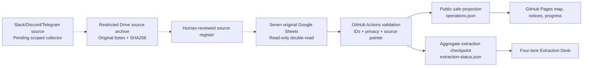

# Operations Four-lane Extraction — Run OPS-B001

**Date:** 14 November 2026 (Asia/Kathmandu). **Owner:** JP Site Operations. **Purpose:** Create an inspectable, bounded source-backed first checkpoint and a public read-only extraction desk; do not manufacture current field activity or duplicate editable registers.

## Starting point and source readback

The last released site before this work was [v2.9.0](https://github.com/FabinGurung/jp-site-operations/releases/tag/v2.9.0) at commit `535adfffe7909c17f375feb6b7abd606d9d2a9fd`. The current GitHub Actions publisher `scripts/publish_operations.py` reads all seven registered original Google Sheets with `spreadsheets.readonly` and a two-read equality check. The public v2.9.0 checkpoint contained 29 approved public projects, 22 approved notification rows and 3 reported work entries. Those counts are **not** a current field condition.

[Run 51 reference receipt](https://drive.google.com/file/d/1msLnL4kqYvGycOSYFA58jxrrj_wY8aTJ/view) shows independent lane checkpoints, starting IDs, PRE records, archive receipts, Main acknowledgements and publication closeout. Operations adapts the method **without copying its research facts**.

### Original workbook inventory, as of 14 Nov 2026

All original fact workbooks are in [01 Website Source Sheets — Edit Here](https://drive.google.com/drive/folders/1u4Rg1J3KSZRPnkjlAHOVxpWoq2skRICn), inside [02 Website Sheets and Registers](https://drive.google.com/drive/folders/1QHxD74egNFeQAmvDJzvKmDxEQUOH3Kq6). Publishing directory lives separately under [02 Website Publishing](https://drive.google.com/drive/folders/1DRECcxUaz68mS_WPWbvReKxujmZ2O58t).

| Key | Original Sheet / tab | Inspected source rows | Google Drive last modified (UTC) | Role |
| --- | --- | ---: | --- | --- |
| projects | [Projects and Locations](https://docs.google.com/spreadsheets/d/1JqzjBNBCT_AAIBkuGsIR5VBOJ3_HyifdPDc7K_jF5Bo/edit) / `projects` | 30 (29 public + retired alias) | 2026-11-09 | Identity and listed project state |
| choices | [Website Display Choices](https://docs.google.com/spreadsheets/d/1tDpsphzARq-rk1MExU4DXC8mG_clh-0TXJwRr2qljXU/edit) / `project_publication_settings` | 30 | 2026-11-09 | Per-field publication controls |
| progress | [Project Work](https://docs.google.com/spreadsheets/d/17YPRpaXIdHloH5-lzsjUpNvXLbsDfrIrlsn2jZ-7KKc/edit) / `project_work_items` | 3 | 2026-10-28 | Reported progress; row date 2026-10-09; unverified |
| messages | [Notification Message Sources](https://docs.google.com/spreadsheets/d/1aWHzjEK0doiUcBbqhySiA6DWCp8d-aq2I08McslilAQ/edit) / `message_sources` | 1 | 2026-10-28 | Stable message source, recorded version and SHA256 |
| notices | [Notification Instructions](https://docs.google.com/spreadsheets/d/1ZPtTos8t9Cym_qnpiUhiyuTxndSc6sGzzv390ahAw4I/edit) / `site_notifications` | 22 | 2026-10-28 | Approved notices with source ID, category, review and recorded due date |
| organizations | [Companies and Organizations](https://docs.google.com/spreadsheets/d/1cwubE_4nB2SAEdLu6ry80G0HeNjbBdu4X3DA6jrcQ1E/edit) / `organizations` | 9 | 2026-10-28 | Only active/public/VALID names joined to public projects |
| directory | [Website Publishing Source Directory](https://docs.google.com/spreadsheets/d/17y3ki0SLSG_Hmz8AipfWhhffnKastcjHvRqIdepJMu4/edit) / `00_SOURCE_DIRECTORY` | 34 | 2026-11-12 | Pointer verification ONLY; no joined private tabs read |

These are the **latest original owning workbook IDs verified**. The original Google Sheets are already populated, keyed, categorized and joined through stable IDs, but **not all content is current or fully normalized**. Three Project Work rows are `IN_PROGRESS` and `UNVERIFIED`; none proves certified completion. One recorded message source can support multiple reviewed notifications. A recorded SHA256 in a register is **not** independent verification of original attachment bytes.

## Four bounded lanes

| Lane | Source / verification | Expected normalized output | B001 stopping point | Next action |
| --- | --- | --- | --- | --- |
| **01 Message & evidence inventory** | Original `message_sources` (1); preserved provider message ID, project ID, original link, version, SHA-256 metadata; Slack public search does not substitute for channel-specific evidence | Source record keyed by `(provider, channel_id, message_id, version)`; archived bytes/attachments kept private, hash on actual bytes | Count and cross-link existing recorded source; stop without new provider ingestion | Authorize/map one project channel; read at most 3 messages and check version/attachments/edited/deleted state |
| **02 Reviewed instructions** | Original `site_notifications` (22); match source ID/version, project ID, published review state, due date and exact recorded language | Existing `site_notifications` with stable notification ID + FK to source; approved public projection | Review registry/foreign-key coverage; do **not** label open/closed without a resolved field | Resolve provenance or review gaps before publishing new instructions |
| **03 Reported progress** | Original `project_work_items` (3); exact project ID, work ID, source, unit, reported state, verification and source row date | Original `project_work_items`; public field-limited report projection (no rates or private evidence) | Preserve 3 historical `IN_PROGRESS` / `UNVERIFIED` rows dated 2026-10-09; don't call certified | Pilot one newly reviewed field activity after A7 PRE snapshot |
| **04 Materials, plant & crew demand** | Existing [Project Resources](https://docs.google.com/spreadsheets/d/1e019Jac4lDveZ2glXMph4RLHivqPFEachbcNi-R1DZk/edit), [Company Project Site Issues](https://docs.google.com/spreadsheets/d/1j_866LE1heYTozkUheH3kU55TV8ZXuLzTwTCZzZNbqw/edit), [Rohini Daily Progress](https://docs.google.com/spreadsheets/d/1agDIiVfTwicWAxix07HaukX7EemNdO4IyghYcBH_kys/edit), [Fishtail Daily Progress](https://docs.google.com/spreadsheets/d/1-pE1d4uxytIZsKF8Tzu3eBDlXL4MLIYiGGvVoKMqo1k/edit). These are candidate separately owned sources, not approved public demand feeds. | When admitted, project-keyed demand records with type/quantity/unit/date/urgency/reviewer; separate from private attendance, payroll and finance | Mark demand UNKNOWN, never zero; no ingestion and no new Sheets created | Choose one approved demand field contract and source with its owner before extracting any rows |

**Provider scope:** Google Sheets input exists in Actions; Slack public search is available interactively but no reviewed mapping/collector in this publisher. Discord and Telegram are not connected to the current GitHub Actions workflow. An isolated Slack public-channel welcome message is not a construction report. No private Slack/Discord/Telegram content may be copied into public Git or Pages. New provider ingestion requires source/channel grants, row-level review, stable IDs and evidence preservation.

## Architecture: provider → evidence → original Sheet → public status

Each original message occurrence keeps provider/channel/message/attachment ID and time; identical hashes can coexist under multiple IDs. Sheet source fields and typed units remain unchanged; changes to original source facts are made in the same live workbook ID after a PRE copy, source readback and POST copy. Only code, manifests, tests and generated projections live in the public repository. Preserve raw provider messages and all private evidence outside public GitHub.

## B001 verification and stop rule

1. **PRE:** exact v2.9.0 commit and seven source file IDs read; no source-record mutation required for this baseline. Run 51's PRE/POST process applies before the *next real edit* to an original Sheet.
2. **Batch:** read seven workbook tabs and their latest identity/permission values, reconcile source counts, unique primary IDs, project/source/organization foreign-key warnings, source-directory pointers and source date vs publisher date. Save public aggregates only. No speculative field facts.
3. **POST:** `extraction-status.json` generated per successful authenticated Actions run; first B001 checkpoint established; `extraction.html` renders the current public-safe aggregate. PR QA verifies app mobile navigation, source overflow, site routes, page integrity and no private-row leak. Release tag only after real Pages verification.
4. **Stop:** B001 ends on verified seven-source readback and deployed checkpoint. It does **not** continue through Slack, Discord or Telegram without a scoped, reviewed provider mapping. Next pilot = **one** project channel, **up to three** messages after authorization/source review; preserve any unresolved issues under Operations Issue #30.

## Record state contract

Use `DISCOVERED → CAPTURED → VERIFIED → REVIEWED → PUBLIC_APPROVED → PUBLISHED` where each state has evidence; `INCOMPLETE`, `UNRESOLVED`, `BLOCKED`, `RETRACTED` and `SUPERSEDED` remain distinct. A stale source does not become fresh because Actions runs hourly. The website must label **read time**, **field event date**, and **source modified time** separately. A deleted provider record requires a tombstone with ID and reason, not silent disappearance.

**No original Google Sheet records were changed in B001.** Source changes remain governed by the user's A7 same-live-ID, PRE/POST, audit log and readback procedure.
